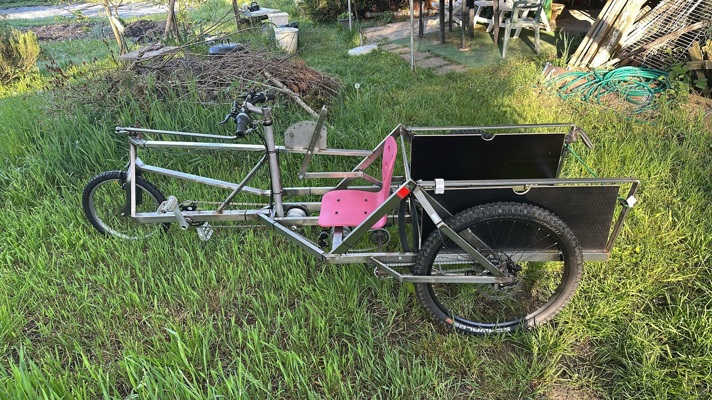

# Cyclo-Terre

Le Cyclo-Terre est un porte-outils maraîcher léger, à traction humaine, conçu pour les micro-fermes.
Il travaille le sol en surface, transporte jusqu'à 250 kg et se répare avec des pièces de vélo standard.

Ce dépôt contient tout ce qu'il faut pour le construire, le modifier et partager vos améliorations :
fichiers CAO, plans, nomenclature et instructions d'assemblage.

> **État : prototype (v0.1).** Les plans décrivent le premier prototype, construit en février 2026 et
> en essai sur le terrain. Ils ne sont pas encore validés pour une utilisation régulière. La version
> commerciale est prévue pour 2028.

Site du projet et formations : [cyclo-terre.ch](https://cyclo-terre.ch)

## Caractéristiques du prototype

| | |
| --- | --- |
| Charge utile | jusqu'à 250 kg |
| Voie | pensée pour les planches de 75 cm |
| Largeur hors tout | 92 cm |
| Poids à vide | 50 kg |
| Cadre | profilés inox |
| Transmission, freins, roues | pièces de vélo standard |
| Outils | sarcloir, semoir, disques butteurs, herse rotative |

## Contenu du dépôt

| Dossier | Contenu |
| --- | --- |
| [`cao/`](cao/) | Fichiers CAO sources et exports STEP |
| [`plans/`](plans/) | Plans cotés (PDF) et fichiers de découpe (DXF) |
| [`nomenclature/`](nomenclature/) | Liste des pièces, quantités, matières et fournisseurs |
| [`assemblage/`](assemblage/) | Instructions de montage pas à pas, réglages, contrôles |
| [`outils/`](outils/) | Un dossier par outil (sarcloir, semoir…), avec la même organisation |
| [`CHANGELOG.md`](CHANGELOG.md) | Ce qui change d'une version à l'autre |

## Par où commencer

1. Lisez les [limites d'usage et consignes de sécurité](assemblage/README.md#sécurité).
2. Rassemblez les pièces de la [nomenclature](nomenclature/).
3. Suivez les [instructions d'assemblage](assemblage/).
4. Vous avez construit un Cyclo-Terre ? [Partagez-le](https://github.com/Cyclo-Terre-Org/Cyclo-Terre/issues/new?template=construction.yml) : vos retours font évoluer les plans.

Outillage nécessaire pour la construction : [À COMPLÉTER — par exemple poste à souder TIG, scie à
ruban, perceuse à colonne, outillage vélo].

## Contribuer

Signaler un problème, proposer une amélioration, partager votre construction ou votre adaptation à
votre sol : tout est expliqué dans le [guide de contribution](CONTRIBUTING.md).

## Licences

Le Cyclo-Terre est du **matériel libre**.

- **Matériel** (fichiers CAO, plans, nomenclature) : [CERN-OHL-S v2](LICENSES/CERN-OHL-S-2.0.txt).
  Vous pouvez fabriquer, modifier et vendre le Cyclo-Terre. Si vous distribuez une version modifiée,
  ou des machines fabriquées d'après une version modifiée, vous devez en publier les sources sous la
  même licence.
- **Documentation** (textes, instructions, photos, schémas) : [CC BY-SA 4.0](LICENSES/CC-BY-SA-4.0.txt).
  Vous pouvez la réutiliser et l'adapter en citant Cyclo-Terre et en gardant la même licence.

Le détail de ce qui relève de chaque licence est dans [LICENSE.md](LICENSE.md). Les marques
« Cyclo-Terre » et le logo ne sont pas couverts par ces licences.

## Contact

contact@cyclo-terre.ch · Genève
